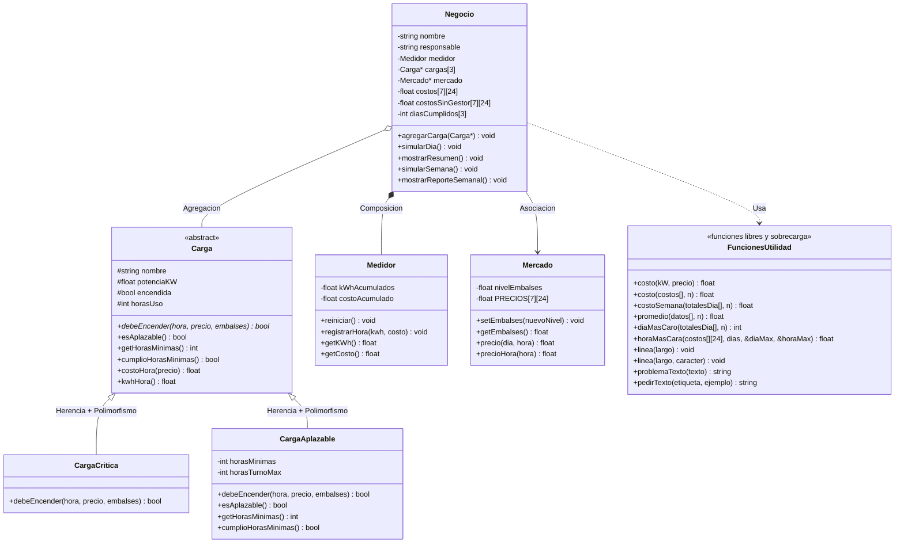

# 🥖 WattControl: Gestor Inteligente de Energía para Panadería (EA3)


-orange)

-green)


Sistema de gestión energética en C++ diseñado para la **Panadería El Trigo de Oro**, ampliado en la **Evidencia de Aprendizaje 3 (EA3)** con simulación de una semana real (21 al 27 de septiembre de 2026) mediante matrices `[7][24]`, funciones propias y sobrecargadas, validación de textos con `string`, reporte semanal completo y prototipo en Arduino (TinkerCad Circuits).

---

## 🏛️ Información Académica

- **Institución:** Institución Universitaria Digital de Antioquia (IU Digital)
- **Facultad:** Facultad de Ingeniería · Ingeniería de Software
- **Asignatura:** Programación Orientada a Objetos (`PREICA2602B020043`)
- **Docente:** Prof. Carlos Arturo Castro Castro
- **Evaluación:** Evidencia de Aprendizaje 3 (EA3)
- **Negocio Asignado:** **Panadería** (Último dígito de documento: `0 – 1`)
- **Repositorio:** `wattcontrol-panaderia-equipo1` (Etiqueta oficial: `ea3`)

---

## 🔗 Accesos Rápidos a Entregas (EA2 y EA3)

- 🚀 **[Ver entrega actual EA3 (Tag `ea3`)](https://github.com/jorgerubio-better/wattcontrol-panaderia-equipo1/tree/ea3)**
- 🎬 **Video de Sustentación EA3:** *(En producción — próximamente disponible en vdbcreator.com)*
- 🔌 **[Ver Circuito Público en TinkerCad (Reto Extra +0,3)](https://www.tinkercad.com/things/9GOirWZ5FvB-circuito-tinkercad)**
- 📦 **[Ver código y README exacto de la EA2 (Tag `ea2`)](https://github.com/jorgerubio-better/wattcontrol-panaderia-equipo1/tree/ea2)**
- 🎥 **[Ver Video de Sustentación EA2 en vdbcreator.com](https://vdbcreator.com/screening/WattControlPanaderia)**

---

## 👥 Equipo de Desarrollo (Equipo 1)

| Integrante | Usuario GitHub | Aportes Técnicos en EA3 |
| :--- | :---: | :--- |
| **Jorge Alejandro Rubio Giraldo** *(Creador del repo)* | [`@jorgerubio-better`](https://github.com/jorgerubio-better) | Constantes de semana real (`DIAS_SEMANA`, `SEMANAS_MES`, `DIAS[]`), funciones propias (`promedio`, `diaMasCaro`, `horaMasCara`, `costoSemana`), sobrecarga (`costo()`, `linea()`), diagrama UML actualizado y documentación. |
| **Luisa Fernanda Parra Arboleda** | [`@luisaparra25`](https://github.com/luisaparra25) | Matriz `PRECIOS[7][24]` en `Mercado` (21 al 27 de sept. de 2026), método `precio(int dia, int hora)` sin `rand()` y validación de textos (`empty()`, `length()`, `size()`, `at()`, `isupper()`). |
| **Maribel Román Ospina** | [`@mariospina03-wq`](https://github.com/mariospina03-wq) | Matriz `costos[7][24]` y contadores `diasCumplidos[]` en `Negocio`, método `simularSemana()` con ciclos `for` anidados (`7 x 24`), polimorfismo, Regla 6 e integración en el menú (opciones 5 y 6). |
| **Deivis Alfonso Yancé Rosado** | [`@deivisJVC`](https://github.com/deivisJVC) | Método `mostrarReporteSemanal()` con tabla diaria, día y hora más caros, proyección mensual (`x 4`), cumplimiento de horas mínimas y código Arduino para reto extra en TinkerCad. |

---

## 🏗️ Diagrama de Clases Actualizado (EA3)

Mantiene las **5 relaciones de POO** e incorpora las matrices `[7][24]`, los nuevos métodos y las funciones propias/sobrecargadas:



---

## 📊 Resultados de la Semana Real (21 al 27 de septiembre de 2026)

Resultados obtenidos ejecutando la **Opción 5 (Simular la semana real)** con embalses al `65.0 %`:

| Día (Fecha) | Con Gestor (COP) | Sin Gestor (COP) | Ahorro del Día (COP) |
| :--- | :---: | :---: | :---: |
| Lunes (21/09) | $70.546 | $179.764 | $109.218 |
| Martes (22/09) | $71.415 | $184.184 | $112.769 |
| Miércoles (23/09) | $72.151 | $189.935 | $117.784 |
| Jueves (24/09) | $62.689 | $196.196 | $133.507 |
| Viernes (25/09) | $72.490 | $187.148 | $114.658 |
| Sábado (26/09) | $66.765 | $167.003 | $100.238 |
| Domingo (27/09) | $63.881 | $159.640 | $95.759 |
| **TOTAL SEMANAL** | **$479.937** | **$1.263.870** | **$783.933 (62.0 %)** |

- **Día más caro (con gestor):** Viernes (25/09) — `$72.490 COP`
- **Hora más cara de la semana:** Miércoles (23/09) a las `10:00 h` — `$6.519 COP` (Bolsa XM: `$795 COP/kWh`)
- **Promedio diario (con gestor):** `$68.562 COP/día`
- **Proyección de ahorro mensual (`× 4`):** `$3.135.732 COP/mes`
- **Cumplimiento de horas mínimas:**
  - `Horno eléctrico`: **7 de 7 días** cumplidos (mínimo `6 h/día`)
  - `Amasadora`: **7 de 7 días** cumplidos (mínimo `4 h/día`)

---

## 🚀 Compilación y Ejecución

```bash
g++ -std=c++17 -Wall -Wextra wattcontrol.cpp -o wattcontrol
./wattcontrol
```

---

## 🔌 Reto Extra: TinkerCad Circuits (Arduino UNO)

- 👉 **Circuito público en vivo:** [https://www.tinkercad.com/things/9GOirWZ5FvB-circuito-tinkercad](https://www.tinkercad.com/things/9GOirWZ5FvB-circuito-tinkercad)
- El código Arduino se encuentra en [`tinkercad/wattcontrol_arduino.ino`](tinkercad/wattcontrol_arduino.ino):
- **Potenciómetro (`A0`):** simula el precio de bolsa XM entre `$350` y `$1.650 COP/kWh`.
- **3 LEDs (pines `13`, `12`, `11`):** representan la `Nevera` (crítica, siempre ON), el `Horno` (`7.0 kW`) y la `Amasadora` (`2.2 kW`).
- **Monitor Serial:** imprime hora, precio XM, estado de cada carga, kW totales y costo por hora aplicando las reglas y el tope de `9.0 kW` (Regla 6).

---

## 🏷️ Etiqueta de Entrega (Git Tag)

```bash
git checkout ea3
```
